# Authentication & Authorization System

> **Backend Feature Documentation**  
> Real-Estate Management System | MERN Stack

---

## 1. Overview

The Authentication & Authorization system is responsible for managing user identity, secure account access, authentication sessions, token renewal, logout, and role-based access control within the Real-Estate Management System.

This feature provides a secure mechanism for users to register, log in, access protected resources, renew their authentication tokens, and retrieve their profiles.

The system uses:

- **JWT (JSON Web Token)** for authentication.
- **Access Token** for accessing protected APIs.
- **Refresh Token** for renewing authentication tokens.
- **bcrypt** for password and Refresh Token hashing.
- **HttpOnly Cookies** for token storage.
- **MongoDB & Mongoose** for user data persistence.
- **Cloudinary** for avatar image storage.

---

## 2. Authentication vs Authorization

| Authentication | Authorization |
|---|---|
| Verifies the identity of a user. | Determines what an authenticated user can access. |
| Uses Access Tokens and JWT verification. | Uses user roles and permission checks. |
| Implemented through `protect.middleware.js`. | Implemented through `roles.middleware.js`. |

---

## 3. Feature Scope

This Authentication & Authorization feature includes:

- User Registration
- User Login
- User Logout
- Access Token Renewal
- Get Current Authenticated User
- Password Hashing
- Refresh Token Hashing
- JWT Authentication
- Protected Routes
- Role-Based Authorization
- Avatar Upload
- Centralized Authentication Error Handling

---

## 4. Backend Folder Structure

```text
server/
└── src/
    ├── config/
    │   ├── cloudinary.config.js
    │   └── db.js
    │
    ├── controllers/
    │   └── auth.controller.js
    │       ├── registerController
    │       ├── loginUser
    │       ├── logoutUser
    │       ├── refreshAccessToken
    │       └── getCurrentUser
    │
    ├── middlewares/
    │   ├── protect.middleware.js
    │   ├── multer.middleware.js
    │   ├── roles.middleware.js
    │   └── error.middleware.js
    │
    ├── models/
    │   └── user.model.js
    │
    ├── routes/
    │   └── auth.routes.js
    │
    └── utils/
        ├── ApiError.js
        ├── ApiResponse.js
        ├── token.util.js
        └── asyncHandler.js
```

---

## 5. Authentication API Routes

### Base URL

```text
/api/v1/auth
```

| Method | Endpoint | Access | Description |
|---|---|---|---|
| POST | `/register` | Public | Register a new user |
| POST | `/login` | Public | Authenticate user |
| POST | `/logout` | Protected | Logout authenticated user |
| POST | `/refresh-token` | Refresh Token | Renew authentication tokens |
| GET | `/me` | Protected | Get authenticated user profile |

---

# 6. Authentication Controllers

## 6.1 Register Controller

### Endpoint

```http
POST /api/v1/auth/register
```

### Purpose

The registration controller creates a new user account and automatically establishes an authenticated session after successful registration.

### Responsibilities

- Validate required registration fields.
- Validate password length.
- Normalize email address.
- Check whether the email already exists.
- Restrict public role assignment.
- Upload optional avatar to Cloudinary.
- Create the user in MongoDB.
- Hash password through the User model's pre-save middleware.
- Generate Access Token and Refresh Token.
- Hash the Refresh Token.
- Store the hashed Refresh Token in MongoDB.
- Set authentication cookies.
- Return safe user information.

### Registration Flow

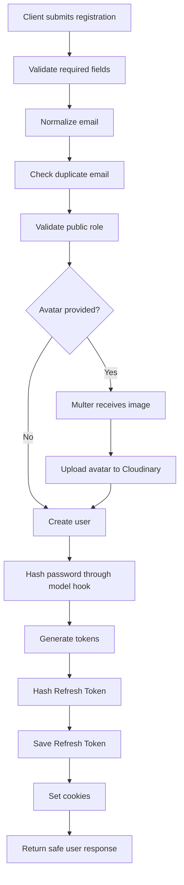

### Process

1. The client submits registration information.
2. The controller validates required fields.
3. The email address is normalized.
4. MongoDB is checked for an existing user.
5. Public role assignment is restricted.
6. If an avatar is provided, Multer receives the image.
7. The avatar is uploaded to Cloudinary.
8. The user is created through `User.create()`.
9. The User model automatically hashes the password.
10. Access Token and Refresh Token are generated.
11. The Refresh Token is hashed and stored in MongoDB.
12. Authentication cookies are set.
13. A safe user response is returned.

### Success Response

```text
201 Created
```

---

## 6.2 Login Controller

### Endpoint

```http
POST /api/v1/auth/login
```

### Purpose

The login controller authenticates an existing user using email and password.

### Responsibilities

- Validate email and password.
- Normalize email.
- Find the user in MongoDB.
- Retrieve the password hash.
- Check whether the account is active.
- Verify password using the User model comparison method.
- Generate Access Token and Refresh Token.
- Hash the Refresh Token.
- Store the Refresh Token hash.
- Set authentication cookies.
- Return safe user information.

### Login Flow

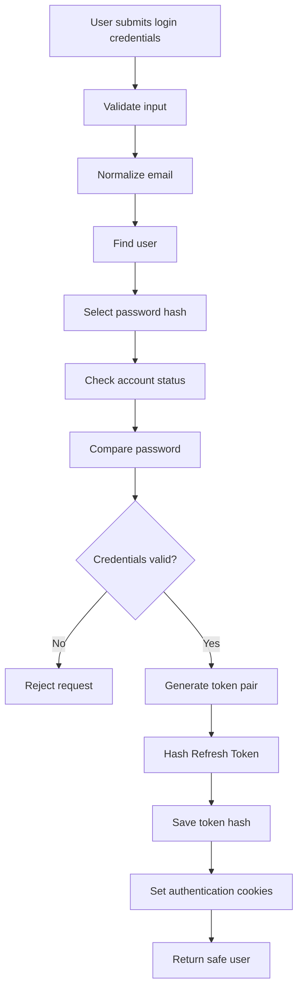

### Process

1. The client submits email and password.
2. The controller normalizes the email.
3. The user is retrieved from MongoDB.
4. The password hash is explicitly selected.
5. The account status is checked.
6. `comparePassword()` verifies the submitted password.
7. New Access and Refresh Tokens are generated.
8. The Refresh Token is hashed.
9. The hashed Refresh Token is saved.
10. Both tokens are set in HttpOnly cookies.
11. Safe user information is returned.

### Success Response

```text
200 OK
```

---

## 6.3 Logout Controller

### Endpoint

```http
POST /api/v1/auth/logout
```

### Middleware

```text
protect.middleware.js
```

### Purpose

The logout controller invalidates the stored Refresh Token and clears authentication cookies.

### Responsibilities

- Access the authenticated user through `req.user`.
- Retrieve the user's stored Refresh Token.
- Invalidate the stored Refresh Token.
- Save the user record.
- Clear Access Token cookie.
- Clear Refresh Token cookie.
- Return logout success response.

### Logout Flow

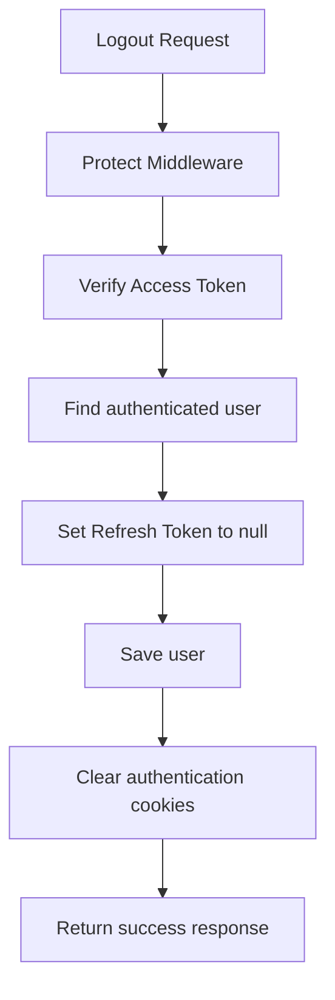

### Process

1. The request passes through the protect middleware.
2. The Access Token is verified.
3. The authenticated user is identified.
4. The stored Refresh Token is invalidated.
5. The user record is saved.
6. Authentication cookies are cleared.
7. A success response is returned.

### Success Response

```text
200 OK
```

> Logout invalidates the stored Refresh Token and clears browser cookies. An already-issued Access Token may remain valid until expiration unless additional revocation checks are implemented.

---

## 6.4 Refresh Access Token Controller

### Endpoint

```http
POST /api/v1/auth/refresh-token
```

### Purpose

The Refresh Access Token controller renews authentication tokens when the Access Token expires, without requiring the user to log in again.

### Responsibilities

- Retrieve Refresh Token from cookie.
- Verify Refresh Token JWT.
- Identify user from token payload.
- Retrieve the stored Refresh Token hash.
- Compare the incoming Refresh Token using bcrypt.
- Generate a new token pair.
- Hash the new Refresh Token.
- Update the stored Refresh Token hash.
- Replace authentication cookies.

### Refresh Token Flow

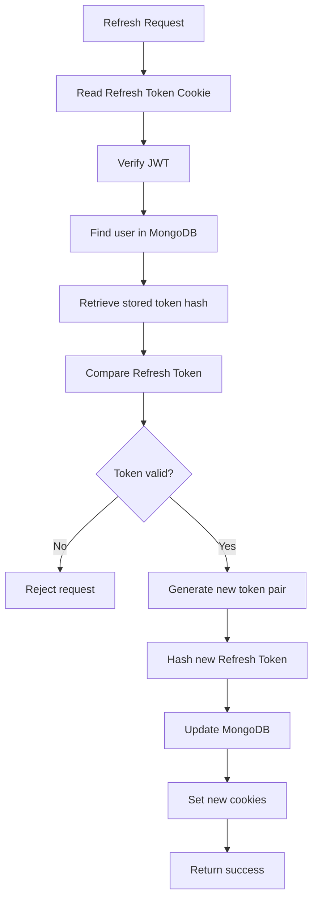

### Process

1. The client sends a Refresh Token cookie.
2. The controller verifies the Refresh Token.
3. The user is identified from the decoded token.
4. The stored Refresh Token hash is retrieved.
5. `bcrypt.compare()` verifies the token.
6. New Access and Refresh Tokens are generated.
7. The new Refresh Token is hashed.
8. MongoDB is updated with the new hash.
9. New authentication cookies are set.
10. A success response is returned.

### Success Response

```text
200 OK
```

> Refresh Token rotation replaces the previously stored Refresh Token hash. This implementation stores a single Refresh Token hash per user, so new logins and refreshes replace the previous stored token.

---

## 6.5 Get Current User Controller

### Endpoint

```http
GET /api/v1/auth/me
```

### Middleware

```text
protect.middleware.js
```

### Purpose

The Get Current User controller returns the profile of the currently authenticated user.

### Responsibilities

- Access authenticated user from `req.user`.
- Create a safe user object.
- Return user profile information.

### Flow

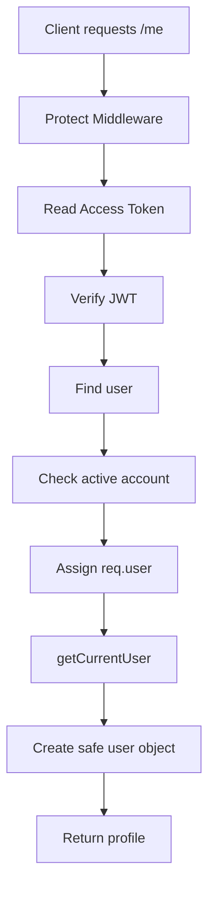

### Process

1. The client sends a GET request to `/me`.
2. The Access Token cookie is read.
3. The protect middleware verifies the JWT.
4. The user is retrieved from MongoDB.
5. The user is assigned to `req.user`.
6. The controller creates a safe user object.
7. The profile response is returned.

### Success Response

```text
200 OK
```

---

# 7. Authentication Middlewares

## 7.1 protect.middleware.js

### Purpose

The protect middleware verifies the user's identity before allowing access to protected routes.

### Responsibilities

- Read Access Token from authentication cookie.
- Optionally read Authorization Bearer Token, if supported.
- Verify JWT signature.
- Verify token expiration.
- Extract user ID from token payload.
- Retrieve user from MongoDB.
- Verify that the user exists.
- Verify that the user account is active.
- Assign authenticated user to `req.user`.
- Allow the request to continue.

### Authentication Flow

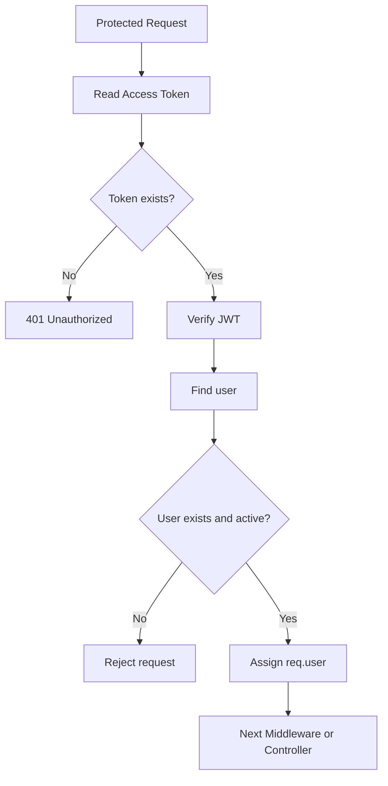

### Expected Errors

| Condition | Response |
|---|---|
| Missing token | `401 Unauthorized` |
| Invalid token | `401 Unauthorized` |
| Expired token | `401 Unauthorized` |
| User not found | `401 Unauthorized` |
| Inactive user | `401 Unauthorized` |

---

## 7.2 multer.middleware.js

### Purpose

The Multer middleware handles incoming avatar file uploads during registration.

### Responsibilities

- Receive avatar file.
- Store file temporarily in memory.
- Validate allowed image MIME types.
- Enforce file size limit.
- Restrict the number of uploaded files.
- Provide uploaded file through `req.file`.

### Registration Integration

```text
Multer Middleware
        |
        v
req.file
        |
        v
Register Controller
        |
        v
Cloudinary Upload
```

### Upload Configuration

The upload middleware is configured according to the project requirements:

- Memory storage.
- Supported image formats.
- Maximum upload size.
- Single avatar file.

> MIME type checks alone do not guarantee that the uploaded file contains valid image data. Production deployments should verify actual image content and apply additional file safety controls.

---

## 7.3 roles.middleware.js

### Purpose

The Roles middleware implements Role-Based Access Control (RBAC).

It restricts access to protected resources based on the authenticated user's role.

### Responsibilities

- Receive permitted roles.
- Check authenticated user from `req.user`.
- Verify that the user's role is permitted.
- Allow access if the role matches.
- Reject access if the role does not match.

### Example

```javascript
protect,
authorizeRoles("admin", "agent"),
controller
```

### Authorization Flow

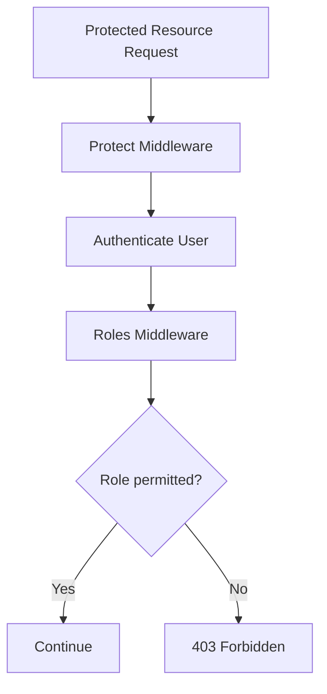

### Expected Errors

| Condition | Response |
|---|---|
| User not authenticated | `401 Unauthorized` |
| User role not permitted | `403 Forbidden` |

> Authentication verifies the user identity. Authorization determines whether the authenticated user can access a specific resource.

---

## 7.4 error.middleware.js

### Purpose

The Error middleware handles backend errors centrally and provides consistent error responses.

### Responsibilities

- Handle custom `ApiError`.
- Handle Mongoose validation errors.
- Handle MongoDB duplicate key errors.
- Handle invalid MongoDB IDs.
- Handle JWT errors.
- Handle expired JWT errors.
- Return standardized error responses.
- Hide stack traces in production.

### Standard Error Response

```json
{
  "success": false,
  "message": "Error message",
  "errors": [],
  "data": null
}
```

### Error Handling Flow

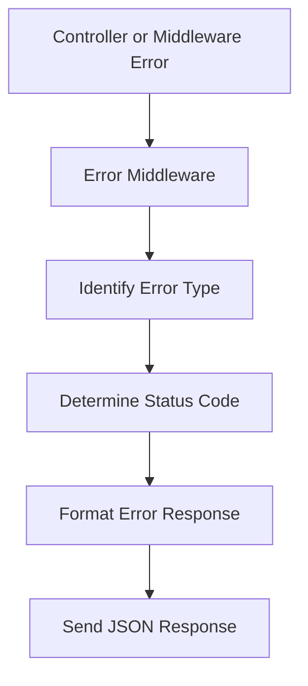

> The error middleware must be registered after the routes in the Express application.

---

# 8. User Model

## user.model.js

### Purpose

The User model defines the user structure and authentication-related behavior.

### Authentication Fields

| Field | Description |
|---|---|
| `fullName` | User's full name |
| `email` | Login identifier |
| `password` | Hashed password |
| `phone` | User contact number |
| `avatar` | Cloudinary avatar information |
| `isActive` | Account status |
| `refreshToken` | Hashed Refresh Token |
| `role` | User authorization role |

### Password Hashing

The User model uses a Mongoose `pre('save')` middleware to hash the password before saving it to MongoDB.

### Password Hashing Process

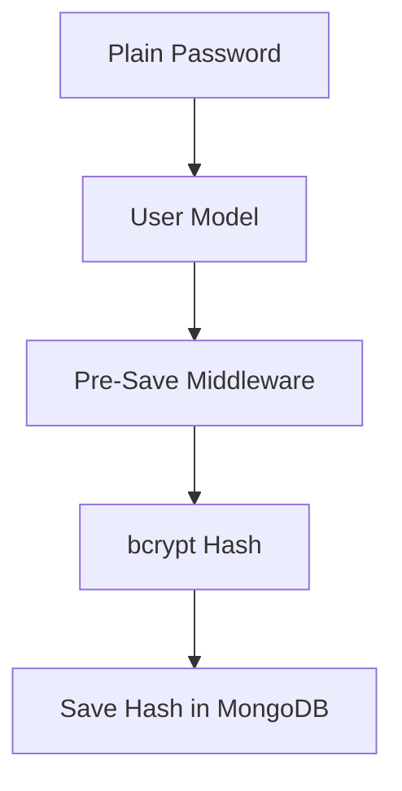

### Password Comparison

The User model provides a password comparison method:

```javascript
user.comparePassword(enteredPassword)
```

The login controller uses this method to verify the submitted password against the stored hash.

### Important Rules

- Password hashing is handled by the User model.
- Controllers do not manually hash passwords before `User.create()`.
- Password field is excluded from normal queries.
- Password must be explicitly selected when required for login.
- Password must never be returned in API responses.

### Refresh Token Storage

- Refresh Token is hashed using bcrypt.
- Stored hash is excluded from normal queries.
- It is explicitly selected when required.
- Logout invalidates the stored hash.
- Refresh replaces the stored hash.

---

# 9. Authentication Routes

## auth.routes.js

### Purpose

The authentication routes connect HTTP requests to authentication controllers and middleware.

### Route Mapping

| Method | Route | Middleware | Controller |
|---|---|---|---|
| POST | `/register` | Multer | `registerController` |
| POST | `/login` | None | `loginUser` |
| POST | `/logout` | Protect | `logoutUser` |
| POST | `/refresh-token` | Refresh verification inside controller | `refreshAccessToken` |
| GET | `/me` | Protect | `getCurrentUser` |

### Route Responsibilities

- Define authentication API endpoints.
- Connect request methods and URLs.
- Apply required middleware.
- Connect controllers.
- Protect authenticated routes.

### Route Protection

The following routes require Access Token authentication:

```text
/logout
/me
```

The following routes do not require an active Access Token:

```text
/register
/login
/refresh-token
```

The Refresh Token endpoint validates its own Refresh Token.

### Role-Based Route Example

```javascript
router.get(
    "/restricted-resource",
    protect,
    authorizeRoles("admin"),
    controller
);
```

---

# 10. Utilities

## 10.1 ApiError.js

### Purpose

The ApiError utility creates standardized custom API errors.

### Used For

- Missing required fields.
- Invalid login credentials.
- Duplicate email.
- Unauthorized requests.
- Forbidden access.
- Invalid tokens.
- Missing user.
- Account inactive.

### Responsibilities

- Store HTTP status code.
- Store error message.
- Store additional errors if provided.
- Provide a consistent error structure.

---

## 10.2 ApiResponse.js

### Purpose

The ApiResponse utility standardizes successful API responses.

### Standard Response Structure

```json
{
  "statusCode": 200,
  "success": true,
  "message": "Success",
  "data": {}
}
```

### Responsibilities

- Store HTTP status code.
- Determine success status.
- Store message.
- Store response data.

All authentication controllers use ApiResponse for consistent success responses.

---

## 10.3 token.util.js

### Purpose

The Token utility generates Access Tokens and Refresh Tokens using JWT.

### Token Types

| Token | Expiration | Purpose |
|---|---|---|
| Access Token | 15 minutes | Access protected API resources |
| Refresh Token | 7 days | Renew authentication tokens |

### Responsibilities

- Generate Access Token.
- Generate Refresh Token.
- Generate token pair.

### Environment Variables

```env
ACCESS_TOKEN_SECRET=your_access_token_secret
ACCESS_TOKEN_EXPIRY=15m

REFRESH_TOKEN_SECRET=your_refresh_token_secret
REFRESH_TOKEN_EXPIRY=7d
```

### Token Generation Flow

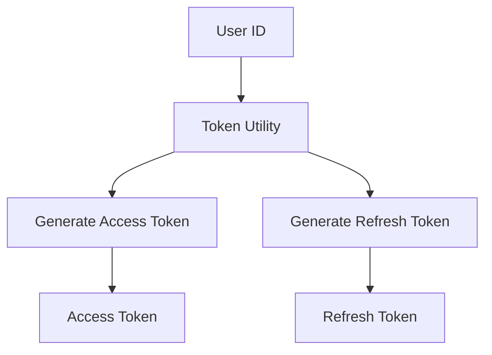

> Access Token and Refresh Token must use separate strong secrets.

---

## 10.4 asyncHandler.js

### Purpose

The asyncHandler utility handles asynchronous Express controller errors.

### Responsibilities

- Wrap asynchronous controllers.
- Catch rejected promises.
- Forward errors to the central error middleware.

### Benefits

- Reduces repetitive try/catch blocks.
- Keeps controllers clean.
- Centralizes error handling.

---

# 11. Configuration

## 11.1 cloudinary.config.js

### Purpose

Configures Cloudinary for avatar image storage.

### Responsibilities

- Load Cloudinary credentials.
- Configure Cloudinary SDK.
- Export the configured Cloudinary instance.

### Environment Variables

```env
CLOUDINARY_CLOUD_NAME=your_cloud_name
CLOUDINARY_API_KEY=your_api_key
CLOUDINARY_API_SECRET=your_api_secret
```

### Avatar Upload Process

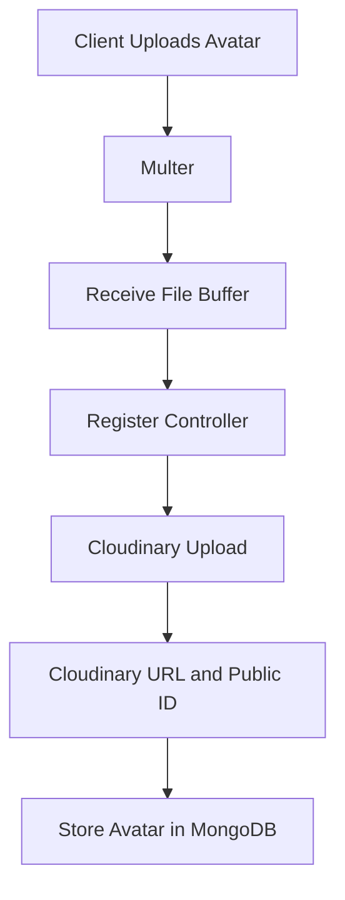

### Cloudinary Responsibilities

- Store user avatars.
- Return image URL.
- Return public ID.
- Provide avatar deletion when cleanup is required.

---

## 11.2 db.js

### Purpose

The database configuration establishes a MongoDB connection through Mongoose.

### Responsibilities

- Read MongoDB connection URI.
- Connect to MongoDB.
- Handle connection errors.
- Provide database connectivity.

### Environment Variable

```env
MONGODB_URI=your_mongodb_connection_string
```

### Database Connection Flow

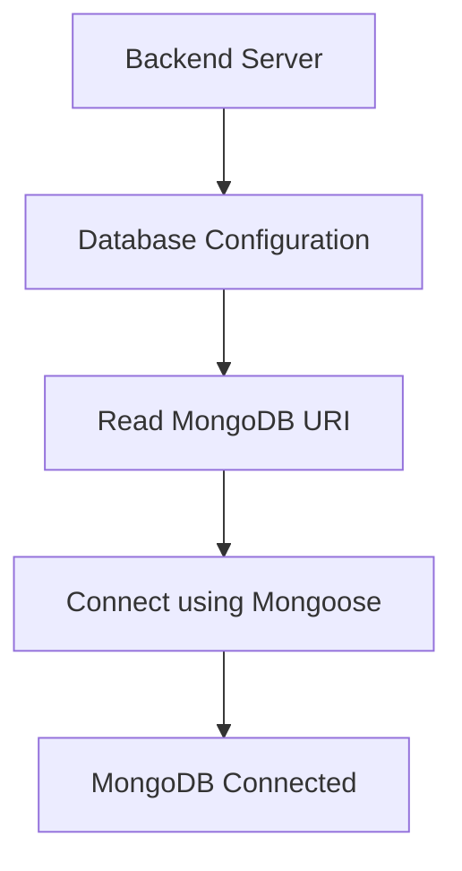

The server should establish its database connection before accepting requests that require database access.

---

# 12. Environment Variables

Example `.env` configuration:

```env
PORT=3000
NODE_ENV=development

MONGODB_URI=your_mongodb_connection_string

ACCESS_TOKEN_SECRET=your_access_token_secret
ACCESS_TOKEN_EXPIRY=15m

REFRESH_TOKEN_SECRET=your_refresh_token_secret
REFRESH_TOKEN_EXPIRY=7d

CLOUDINARY_CLOUD_NAME=your_cloud_name
CLOUDINARY_API_KEY=your_api_key
CLOUDINARY_API_SECRET=your_api_secret
```

> Never commit `.env` files, token secrets, or private Cloudinary credentials to GitHub.

---

# 13. Authentication Cookies

Authentication tokens are stored in HttpOnly cookies.

### Cookie Configuration

| Property | Purpose |
|---|---|
| `httpOnly` | Prevents client-side JavaScript from directly accessing the cookie |
| `secure` | Requires HTTPS in production |
| `sameSite` | Defines cross-site cookie behavior |
| `path` | Defines the cookie path |
| `maxAge` | Defines cookie lifetime |

### Token Lifetime

| Cookie | Lifetime |
|---|---|
| Access Token | 15 minutes |
| Refresh Token | 7 days |

### Cookie Flow

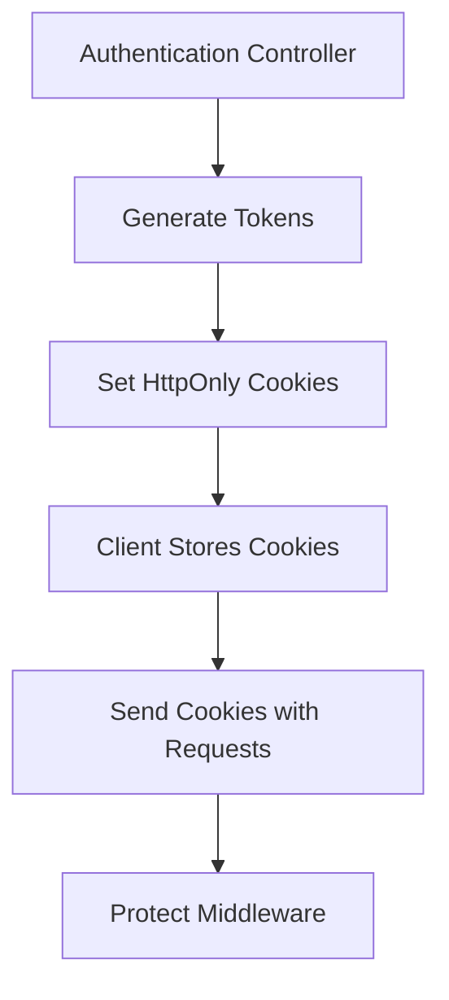

> Cookie settings must be configured according to frontend origin, HTTPS, CORS, and deployment requirements. Cookie-based authentication must also consider CSRF protection.

---

# 14. Postman Testing

### Base URL

```text
http://localhost:3000/api/v1/auth
```

### Authentication Test Cases

| ID | Test Case | Endpoint | Expected |
|---|---|---|---|
| AUTH-01 | Register valid user | POST `/register` | 201 |
| AUTH-02 | Register without fullName | POST `/register` | 400 |
| AUTH-03 | Register without email | POST `/register` | 400 |
| AUTH-04 | Register without password | POST `/register` | 400 |
| AUTH-05 | Register short password | POST `/register` | 400 |
| AUTH-06 | Register duplicate email | POST `/register` | 409 |
| AUTH-07 | Register with avatar | POST `/register` | 201 |
| AUTH-08 | Login valid credentials | POST `/login` | 200 |
| AUTH-09 | Login wrong password | POST `/login` | 401 |
| AUTH-10 | Login unknown email | POST `/login` | 401 |
| AUTH-11 | Logout authenticated user | POST `/logout` | 200 |
| AUTH-12 | Logout without token | POST `/logout` | 401 |
| AUTH-13 | Refresh valid token | POST `/refresh-token` | 200 |
| AUTH-14 | Refresh without token | POST `/refresh-token` | 401 |
| AUTH-15 | Refresh invalid token | POST `/refresh-token` | 401 |
| AUTH-16 | Get current user | GET `/me` | 200 |
| AUTH-17 | Get current user without token | GET `/me` | 401 |
| AUTH-18 | Get current user with invalid token | GET `/me` | 401 |
| AUTH-19 | Refresh after logout | POST `/refresh-token` | 401 |
| AUTH-20 | Access restricted route with wrong role | Protected route | 403 |

### Recommended Testing Sequence

1. Register a new user.
2. Verify registration response.
3. Verify authentication cookies.
4. Login using registered credentials.
5. Test `GET /me`.
6. Test `GET /me` without cookies.
7. Test invalid Access Token.
8. Test Refresh Token.
9. Test `GET /me` using refreshed cookies.
10. Logout.
11. Test Refresh Token after logout.
12. Test role-restricted routes.

### Postman Cookie Testing

- Open the Postman Cookies manager.
- Select the appropriate host.
- Verify `accessToken` and `refreshToken`.
- Use the same host for protected requests.
- Remove cookies when testing unauthenticated requests.

---

# 15. Security Considerations

- Passwords are hashed using bcrypt.
- Password hashes are excluded from normal queries.
- Refresh Tokens are hashed in MongoDB.
- Tokens are stored in HttpOnly cookies.
- Access Token and Refresh Token use separate secrets.
- Public registration must not allow privileged role assignment.
- Protected routes must use authentication middleware.
- Role-restricted routes must use authorization middleware.
- Inactive accounts must not be allowed to authenticate.
- Refresh Token rotation replaces the stored hash.
- Authentication errors must not expose sensitive information.
- Stack traces should not be exposed in production.
- Environment variables must not be committed.
- Cookie-based authentication should be configured with appropriate HTTPS, CORS, and CSRF protection.

---

# 16. Authentication Feature Checklist

- [ ] User registration
- [ ] Registration validation
- [ ] Duplicate email protection
- [ ] Password hashing
- [ ] Avatar upload
- [ ] User login
- [ ] Password comparison
- [ ] Access Token generation
- [ ] Refresh Token generation
- [ ] Refresh Token hashing
- [ ] HttpOnly cookies
- [ ] Logout
- [ ] Refresh Token invalidation
- [ ] Token rotation
- [ ] Protected middleware
- [ ] Current user endpoint
- [ ] Role-based authorization
- [ ] Centralized error handling
- [ ] Postman positive tests
- [ ] Postman negative tests

---

# 17. Feature Summary

The Authentication & Authorization feature provides secure user identity management and access control for the Real-Estate Management System.

Users can register, authenticate, log out, renew their authentication tokens, and retrieve their profile information.

The system uses JWT-based authentication, hashed passwords, hashed Refresh Tokens, HttpOnly cookies, protected middleware, and role-based authorization.

This feature provides the security foundation for the remaining backend modules of the Real-Estate Management System.
```

